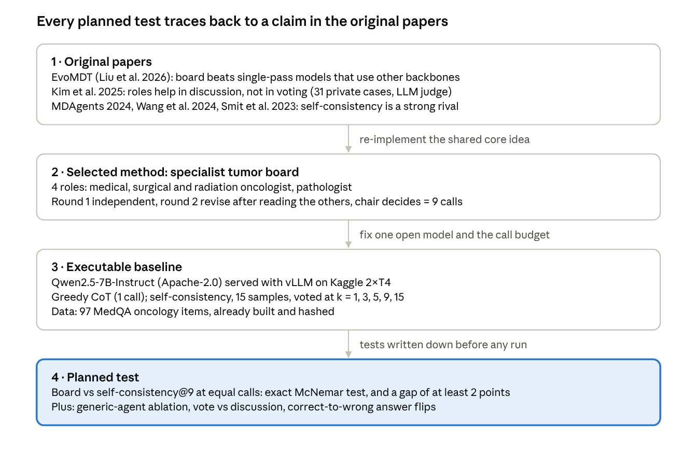
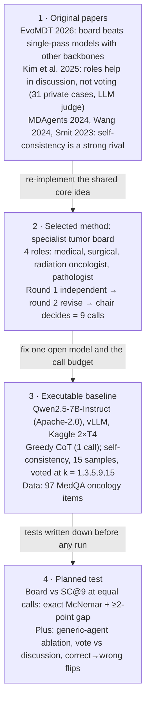

# Prompt 03 output — Literature-to-experiment map and mandatory bridge

Saved: 2026-10-23 · Tool: Claude · Labels: VERIFIED / INFERRED / UNKNOWN
Prompt 03 SAVE item: "Mandatory bridge: original papers → selected method → executable baseline → planned test."

## Prompt as used
> My literature review **[LiteratureReview_T32_VibhumSharma.pdf]** identified these candidate gaps: **[G4 multi-agent claims lack independent, fair comparison; G1 complexity gap; G2 answer instability]**. Identify three published methods from my review that could realistically be implemented or reproduced. For each method, map its original paper to the algorithm, dataset, code or model access, evaluation metric, known limitations and computational requirement. Distinguish verified access to code/weights from unverified suggestions. Compare three possible experimental studies: (A) reproduction plus extension, (B) controlled comparison, and (C) targeted modification. For each study state the smallest working baseline, the testable question, expected resource burden and evidence required. Recommend one minimum viable research experiment for **[free Kaggle 2×T4 / Colab T4, local GTX 1050 Ti 4 GB, 16 GB RAM]** and **[about 4 weeks]**. Provide a literature-to-experiment mapping table and list what I must personally verify before coding. Do not propose an elaborate new architecture without a scientific rationale.

## A. Three methods from the review, mapped

None of the three multi-agent systems in the review can be reproduced as published on free GPUs, so the experiment re-implements the shared core idea (specialist agents + discussion + aggregation).

| | M1. EvoMDT (Liu et al. 2026) | M2. Consensus matrix (Han et al. 2025) | M3. Guideline-primed single LLM (Ismayilov et al. 2025) |
|---|---|---|---|
| Algorithm | Specialist agents, guideline RAG, safety agent, coordinator consensus, self-evolving prompts (VERIFIED, PDF) | 7 role agents; agreement by Kendall's W; RL (Q-learning, PPO, DQN) (VERIFIED, arXiv abstract) | One LLM primed with NCI guidelines simulates the board (review only; original not read — UNKNOWN) |
| Data | MedQA, MedQA-Cancer, MedMCQA-Cancer, MedQuAD, MedQARo, ROND + 4 hospital sets "on request" (VERIFIED) | MedQA, PubMedQA, DDXPlus, MedBullets, SymCat (VERIFIED, abstract) | 10 NSCLC immunotherapy cases, private (review) |
| Code / weights | Paper links github.com/KesselZ/EvoMDT; could not be opened from the AI workspace (UNKNOWN). Backbone DeepSeek V3/R1 via API (VERIFIED) | No code or model named (UNKNOWN) | Prompt only (review) |
| Metric | Accuracy (MCQ), BERTScore, physician Likert (VERIFIED) | Accuracy, consensus rate, Kendall's W, expert rating (VERIFIED) | Likert 1–5 (review) |
| Known limits | Retrospective; limited scale/geography; no prospective or outcome study (VERIFIED) | Strongest baseline not named (VERIFIED) | No insight beyond the human MDT (review) |
| Compute | API calls to DeepSeek V3/R1, far too large for a T4 | Many agents + RL training: high | Trivial |

Open implementations outside the review, usable as references: MedAgents (Tang et al. 2024), MDAgents (Kim et al. 2024), Kim et al. (2025). All public on GitHub, OpenAI/Gemini API only, **no licence file** (VERIFIED) → read and cite, do not copy; baseline is my own code.

## B. Three possible studies

| | A. Reproduction + extension | B. Controlled comparison | C. Targeted modification |
|---|---|---|---|
| What | Reproduce EvoMDT (or Kim et al.'s Group Chat), add a new condition | Fix one open model; compare single-model and board methods at equal calls | Change one board part, e.g. discuss only when round-1 members disagree |
| Smallest working baseline | EvoMDT pipeline + its MCQ sets | Greedy CoT (1 call) + self-consistency@k on MedQA oncology items, Qwen2.5-7B | The full board from B |
| Testable question | Does the published gain hold on independent data? | Does a specialist board beat self-consistency at the same call count? Do roles matter? | Does the change keep accuracy with fewer calls? |
| Resource burden | High: code unreachable, API model, private data | Medium: ~34 calls/item, inference only (INFERRED) | Medium, only after B exists |
| Evidence required | Matching published numbers first | Paired accuracy, McNemar, CIs, tokens/item, flip counts | Accuracy-vs-calls curve vs unmodified board |
| Verdict | **Not feasible** | **Recommended** | Possible follow-up |

**Minimum viable experiment:** study B on the 97 MedQA oncology items (already built and hashed), Qwen2.5-7B-Instruct on Kaggle 2×T4 — a conceptual replication of Kim et al. 2025's hypotheses on public data, with call matching as the one new control. No new architecture.

## C. Mandatory bridge

## D. What I must verify myself before coding
- [ ] Open github.com/KesselZ/EvoMDT in my own browser (AI fetch and clone failed)
- [ ] Read EvoMDT Figure 2 for any DeepSeek-only baseline
- [ ] Read MDAgents Table 2 and Section 4.4 myself (numbers came from an AI summary)
- [ ] Read MedAgentsBench results table myself (AI summary)
- [ ] Read Kim et al. 2025 Appendix B tables; confirm call counts are not matched
- [ ] Check my Kaggle weekly GPU quota
- [ ] Confirm the MedMCQA dataset card on Hugging Face (licence, fields, dev size)
