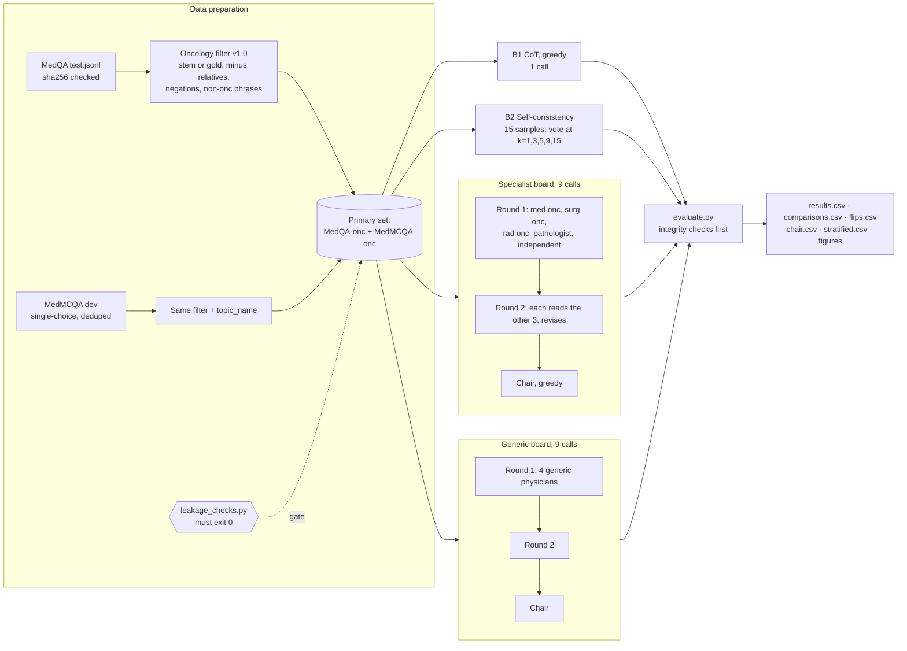

# Prompt 07 output — Frozen evaluation protocol (v1.1)

Frozen: 2026-10-24, before any non-pilot model output exists. Machine-readable copy: `frozen_protocol.yaml` (same as `configs/frozen_protocol.yaml` in the code repository).
Labels: VERIFIED / INFERRED / UNKNOWN.

## 1. Question and design
**RQ1 (primary):** with Qwen2.5-7B-Instruct fixed, is a 4-specialist tumor board (2 rounds + chair, 9 calls) more accurate than self-consistency with 9 samples on oncology exam questions? **RQ2:** does a generic-agent board differ from the specialist board? **RQ3:** does the discussion round change the vote, and how often do members flip correct→wrong vs wrong→correct?
Design: paired, within-item comparison of inference methods; zero-shot; no training.

## 2. Inputs and outputs (precise definitions)

| Object | Definition |
|---|---|
| Item | `{item_id, question, options{A..E or A..D}, answer_idx}`; `item_id` = first 12 hex of SHA-1 of the question text (stable across file order) |
| Prompt (every arm) | System role + user message = question + lettered options + fixed instruction: *"Reason through the case step by step, concisely (no more than about 150 words). Then give your final choice on the last line in exactly this format: Answer: <letter>"* |
| Model call | One chat completion; T = 0.7, top-p = 0.95, max 512 new tokens (CoT and chair: T = 0, chair max 384) |
| Parsed answer | Letter from the last stand-alone `Answer: X` line (or `\boxed{X}` / a bare letter on the last line); otherwise `None` |
| Item outcome | 1 if parsed answer = gold letter, else 0 (`None` counts as 0) |
| Raw output | One JSONL record per item × arm × seed with every call's full text, parsed answer and token counts (`results/raw/`) |

## 3. Modules and data flow

## 4. Pre-processing (fixed)
1. Verify the MedQA file hash (`cfa75cbc…a3`); stop on mismatch.
2. Oncology filter v1.0 (frozen in `src/vtb/data.py`): an oncology term in the question stem or the gold option text, excluding sentences about relatives, negated mentions and non-oncology phrases. MedQA result: 97 / 1,273 (VERIFIED).
3. MedMCQA: dev split, `choice_type == single`, de-duplicated by content hash, same filter plus `topic_name`; `cop` base inferred and checked.
4. Run `leakage_checks.py` (pilot vs test; MedMCQA-onc vs MedQA-onc). Any flagged pair → drop the pilot item or keep one copy of the test item, and log it.

## 5. Partitions and controls
- No training. Debug items = 20 MedQA train items only. Test items are used once per seed under this protocol.
- **Held constant across arms:** model and weights, answer instruction, sampling settings, max tokens, item set, parsing rule, hardware type.
- **Only difference between arms:** how calls are organised (single, sampled-and-voted, board with roles, board without roles).
- **Call budget:** CoT 1; SC@9 9; boards 9 (8 members + 1 chair). SC is also reported at k = 1, 3, 5, 15 to show the cost curve.

## 6. Metrics (direction)

| Metric | Direction | Use |
|---|---|---|
| Accuracy | higher is better | Primary, all RQs |
| Paired accuracy difference + 95% bootstrap CI (10,000 item resamples, seed 20261020) | — | Effect size |
| Exact McNemar p (two-sided) | lower = stronger evidence | Primary and secondary tests (Holm within the secondary family) |
| Parse-failure rate | lower is better | Validity check per arm |
| C→W and W→C member-flip rates + item-cluster bootstrap CI | lower C→W is better | RQ3b |
| API-equivalent tokens and wall-clock seconds per item | lower is better | Efficiency |

**Decision rule (RQ1):** board better if p < 0.05 and difference ≥ +2 points; SC better if p < 0.05 and ≤ −2 points. Otherwise "no difference detected", reported with the CI and the minimum detectable effect for that n (Prompt 05: ≈ 12–15 points at n = 97; ≈ 6–8 points at n ≈ 400).

## 7. Seed plan
Seeds 0, 1, 2 on the primary set (seed 0 = primary analysis; 1–2 = sensitivity); seed 0 only for full MedQA and the 4-option anchor. Per-call seeds are derived as SHA-256(seed | item_id | arm/round/role), so every call is reproducible and arms never share draws by accident. vLLM batching can still cause small non-determinism (checked in validation).

## 8. Compute budget (INFERRED until the smoke test)
About 34 calls per item for all four arms. Minimum run (MedQA-onc × 3 seeds): ≈ 2.5 M generated tokens, ≈ 1–3 GPU-hours on 2×T4. Full MedQA × 1 seed: ≈ 4–12 GPU-hours. MedMCQA-onc scales with its n. Order of cuts if over budget: full MedQA first, then seeds 3 → 1.

## 9. Planned tables and figures (shells — no values until real runs)

**Table 1 — Main results (primary set, seed 0).**

| Method | Calls/item | Accuracy (95% CI) | Δ vs SC@9 (95% CI) | McNemar p | Parse fail % | Tokens/item |
|---|---|---|---|---|---|---|
| CoT (greedy) | 1 | | | | | |
| SC@1 / @3 / @5 / @9 / @15 | 1–15 | | | | | |
| Specialist board (final) | 9 | | | | | |
| Generic board (final) | 9 | | | | | |

**Table 2 — Secondary family (Holm-adjusted).** Rows: specialist vs generic board; round-2 vote vs round-1 vote; specialist board vs CoT. Columns: n, Δ, CI, p, p_Holm, decision.

**Table 3 — By source and seed.** MedQA-onc, MedMCQA-onc and pooled × seeds 0/1/2 for SC@9 and the specialist board.

**Table 4 — Member answer transitions (RQ3b).** C→C, W→C, C→W, W→W counts and rates with CIs, for each board type.

**Figure 1 — Accuracy vs API-equivalent tokens (log x):** SC curve plus single points for CoT and both boards, with 95% CIs.
**Figure 2 — Transition bars** (C→C, W→C, C→W, W→W) for each board.
**Figure 3 (exploratory) — Accuracy by round-1 agreement stratum** (4/4, 3/4, ≤ 2/4).

## 10. Deep analyses
Required (at least one): RQ3b error-propagation analysis and the role ablation. Also planned: chair override analysis, efficiency frontier, seed sensitivity, and two sensitivity subsets (stem-only rule n = 74; human-audited items).

## 11. Threats to validity

| Threat | Type | Mitigation |
|---|---|---|
| Small n (97 alone) | Statistical | Pooled set; minimum detectable effect reported; no "no difference" claims |
| Exam MCQs ≠ tumor-board decisions | Construct | Claims limited to exam accuracy; stated in title and abstract |
| Keyword-defined oncology scope | Construct | Frozen filter, audit file, stem-only and human-audited sensitivity sets |
| Pre-training contamination | Internal / external | Affects all arms equally; stated as a limitation |
| One backbone (Qwen2.5-7B) | External | No claims for other models |
| Prompt wording favours one arm | Internal | Identical answer instruction everywhere; roles differ only in the system message |
| Parser errors differ by arm (longer board texts) | Measurement | Parse-fail rate per arm; manual check of every failure in the pilot |
| Non-determinism in batched inference | Reliability | Seeds logged; 20-item rerun check (Prompt 10) |
| Test-set tuning | Internal | This freeze; git history; prompts only debugged on train items |

## 12. Pre-experiment checklist (all must be ticked before the main grid)
- [x] Primary metric, primary comparison, test, threshold and null-reporting rule written down (this file)
- [x] Item sets defined and MedQA-onc hashed (VERIFIED)
- [x] Seeds and call budgets fixed
- [x] Table and figure shells defined
- [ ] **OPEN:** `evaluate.py` comparison list updated to the v1.1 secondary family (still lists the four v1.0 comparisons) — fix in Prompt 13 *before* any real evaluation
- [ ] MedMCQA-onc built; n and `cop` base recorded in `extra_manifest.json`
- [ ] `leakage_checks.py` passes both checks
- [ ] Smoke test passes on 5 pilot items; parse failures ≤ 3% per arm
- [ ] CoT on MedQA-onc > 27.8%
- [ ] Commit hash of the code used for the main grid recorded in `run_meta.jsonl`

## 13. How legitimate protocol changes are logged
1. Any change after the first non-pilot run gets a new `protocol_version` (1.2, 1.3 …) at the top of the YAML, with a one-line diff comment.
2. A decision-log entry records what changed, why, the evidence, and **which existing runs are affected** (rerun or reported as-is with a note).
3. Results produced under different versions are never pooled (`evaluate.py` refuses mixed `protocol_version` values).
4. Changes made because of test-set results are not allowed. If one is unavoidable (e.g. a parser bug found in test outputs), every arm is re-scored with the fixed parser and the change is reported in the paper.

## 14. Decision-log entries (Prompt 07)

| ID | Date | Decision | Reason | Evidence | Next action |
|---|---|---|---|---|---|
| L-20 | 2026-10-24 | Protocol v1.0 → v1.1 (pooling rule, MDE reporting, 27.8% floor, by-source tables, leakage gate, 3-comparison secondary family) | Prompt 05–06 decisions; no model output existed yet | Git history of `configs/frozen_protocol.yaml` | Freeze v1.1 |
| L-21 | 2026-10-24 | `evaluate.py` must match v1.1 before any real evaluation | The code still holds the v1.0 comparison list | Code read (VERIFIED) | Fix in Prompt 13 |
